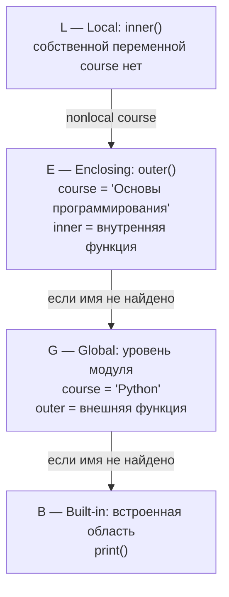

# Министерство науки и высшего образования Российской Федерации

**ФЕДЕРАЛЬНОЕ ГОСУДАРСТВЕННОЕ АВТОНОМНОЕ ОБРАЗОВАТЕЛЬНОЕ УЧРЕЖДЕНИЕ ВЫСШЕГО ОБРАЗОВАНИЯ**

## «НАЦИОНАЛЬНЫЙ ИССЛЕДОВАТЕЛЬСКИЙ УНИВЕРСИТЕТ ИТМО»
*(Университет ИТМО)*

**Факультет:** Прикладной информатики

**Образовательная программа:** 09.03.03 Прикладная информатика

**Направление подготовки (специальность):** Управление эксплуатацией систем ИИ

# ПРАКТИЧЕСКАЯ РАБОТА №3

**По дисциплине:** «Основы программирования»

**Тема:** Алгоритмы, коллекции и функции

**Выполнил:** Паршаков Иван Владимирович, К3141

**Проверил:**

**Дата:**

Санкт-Петербург, 2026

---

# Цель работы

Научиться переводить условие задачи в алгоритм, выбирать подходящую структуру данных и разделять программу на небольшие функции с понятными контрактами.

# Ход работы

## Задание 1. Условия и классификация данных

### Часть 1. Проверка диапазонов

С помощью if / else проверяется, входит ли результат и количество пропусков входит в необходимые диапазоны. Если хотя бы одно условие не выполняется, то выводится сообщение о несоответствии данных и их дальнейшая классификация.

```python
result = int(input('Введите результат студента - целое число от 0 до 100: '))
work_type = input('Укажите тип работы: ')
misses = int(input('Укажите число пропущенных занятий: '))

levels = ["недостаточный", "удовлетворительный", "хороший", "отличный"]
points = [0, 60, 75, 90]

if not (0 <= result <= 100) or not (0 <= misses <= 5):
    print('Введены некорректные значения. Попробуйте заново')
else:
    ...
```

**результат работы:**

```text
Введите результат студента - целое число от 0 до 100: 101
Укажите тип работы: exam
Укажите число пропущенных занятий: 0
Введены некорректные значения. Попробуйте заново
```


### Часть 2. Определение уровня результатов

Создается список со всеми возможными уровнями результатов, далее определяется максимальный подходящий индекс в соответствии с заданными условиями, если пропущено более трех занятий индекс уменьшается на единицу, дополнительно добавлена заглушка на случай, если индекс станет отрицательным (тогда значение станет равным нулю). В переменную fin_level записывается итоговое значение уровня результата с помощью определенного выше индекса.

```python
result = int(input('Введите результат студента - целое число от 0 до 100: '))
work_type = input('Укажите тип работы: ')
misses = int(input('Укажите число пропущенных занятий: '))

levels = ["недостаточный", "удовлетворительный", "хороший", "отличный"]
points = [0, 60, 75, 90]

if not (0 <= result <= 100) or not (0 <= misses <= 5):
    print('Введены некорректные значения. Попробуйте заново')
else:
    level = max(i for i, point in enumerate(points) if result >= point)

    if misses > 3:
        level = max(0, level - 1)

    fin_level = levels[level]
```


### Часть 3. Сопоставление с образцом

Сопоставление с образцом происходит при помощи match / case. Для каждого введенного значение определяется тип работы, если введено что-то неподходящее под условие, то под это предусмотрена отдельная ветвь, результаты записываются в переменную fin_type.

```python
match work_type:
    case 'exam':
        fin_type = 'Экзаменационная работа'
    case 'project':
        fin_type = 'Проектная работа'
    case 'practice':
        fin_type = 'Практическая работа'
    case _:
        fin_type = 'Неизвестный вид работы'
```

### Часть 4. Тестовые сценарии


**Результат работы на граничных значениях:**

Для проверки использованы значения на нижних и верхних границах каждого диапазона. При отсутствии пропусков результаты классифицируются следующим образом:

```text
Результат: 0   — недостаточный
Результат: 59  — недостаточный
Результат: 60  — удовлетворительный
Результат: 74  — удовлетворительный
Результат: 75  — хороший
Результат: 89  — хороший
Результат: 90  — отличный
Результат: 100 — отличный
```

1. **Порядок проверки условий:**

   Сначала программа проверяет корректность результата и числа пропусков. Если результат находится вне диапазона 0–100 или число пропусков — вне диапазона 0–5, выводится сообщение об ошибке, а вычисление уровня не выполняется. Иначе выбирается максимальный порог из списка [0, 60, 75, 90], который не превышает результат. Затем, если пропущено больше трёх занятий, уровень понижается на одну ступень, но не ниже «недостаточного». В конце match case определяет название типа работы.

2. **Недостижимые ветви и замечания:**

   В конструкции match case все четыре ветви синтаксически достижимы: exam, project, practice и case _. Ветка case _ срабатывает только для любого значения work_type, отличного от трёх указанных строк. При проверке уровней отдельные пороги не являются недостижимыми: благодаря поиску максимального подходящего порога значения 0, 60, 75 и 90 корректно задают нижние границы уровней.

### Практическое расширение

Обрабатывается список из десяти записей, для каждой записи с помощью f-строки формируется строка результата и добавляется в список индивидуальных результатов, в конце с помощью заранее созданного словаря count_levels подсчитывается число студентов каждого уровня. Программа выводит индивидуальные результаты и итоговую сводку.

```python
students = [
    (82, "exam", 4),
    (95, "project", 1),
    (67, "practice", 2),
    (54, "exam", 0),
    (76, "project", 5),
    (91, "practice", 3),
    (73, "exam", 4),
    (88, "project", 0),
    (60, "practice", 1),
    (100, "exam", 5)
]

stats = []
count_levels = {
    'недостаточный': 0,
    'удовлетворительный': 0,
    'хороший': 0,
    'отличный': 0
}

levels = ["недостаточный", "удовлетворительный", "хороший", "отличный"]
points = [0, 60, 75, 90]

for student in students:
    result = student[0]
    work_type = student[1]
    misses = student[2]

    if not (0 <= result <= 100) or not (0 <= misses <= 5):
        print('Введены некорректные значения. Попробуйте заново')
    else:
        level = max(i for i, point in enumerate(points) if result >= point)

        if misses > 3:
            level = max(0, level - 1)

        fin_level = levels[level]

        match work_type:
            case 'exam':
                fin_type = 'Экзаменационная работа'
            case 'project':
                fin_type = 'Проектная работа'
            case 'practice':
                fin_type = 'Практическая работа'
            case _:
                fin_type = 'Неизвестный вид работы'

        total_result = f'Студент {students.index(student) + 1}: {fin_level}; {fin_type}'
        stats.append(total_result)
        count_levels[fin_level] += 1
        print(total_result)

print(count_levels)
```

**результат работы:**

```text
Студент 1: удовлетворительный; Экзаменационная работа
Студент 2: отличный; Проектная работа
Студент 3: удовлетворительный; Практическая работа
Студент 4: недостаточный; Экзаменационная работа
Студент 5: удовлетворительный; Проектная работа
Студент 6: отличный; Практическая работа
Студент 7: недостаточный; Экзаменационная работа
Студент 8: хороший; Проектная работа
Студент 9: удовлетворительный; Практическая работа
Студент 10: хороший; Экзаменационная работа
{'недостаточный': 2, 'удовлетворительный': 4, 'хороший': 2, 'отличный': 2}
```


## Задание 2. Циклы и базовые алгоритмические схемы

```python
measurements = [12, 15, 11, 18, 18, 9, 21, 15, 7, 18]

summ = 0
min_num = float('+inf')
max_num = float('-inf')
even_num = 0
count_above_average = 0

for num in measurements:
    summ += num  # сумма

    if num < min_num:  # минимум
        min_num = num

    if num > max_num:  # максимум
        max_num = num

    if num % 2 == 0:  # чётные
        even_num += 1

average = summ / len(measurements)

for number in measurements:
    if number > average:  # превосходит среднее арифметическое
        count_above_average += 1

print(summ, min_num, max_num, even_num, count_above_average)
```

**результат работы:**

```text
144 7 21 4 6
```


В программе выполняется обработка списка measurements, содержащего значения измерений. Создаются переменные для хранения суммы элементов (summ), минимального (min_num) и максимального (max_num) значений, количества чётных элементов (even_num) и количества значений, превышающих среднее арифметическое (count_above_average). Для поиска минимума и максимума используются положительная и отрицательная бесконечности соответственно. В цикле каждый элемент прибавляется к общей сумме. Затем он сравнивается с текущими минимумом и максимумом, которые при необходимости обновляются. С помощью операции % также проверяется чётность элемента: если остаток от деления на 2 равен нулю, счётчик чётных значений увеличивается на единицу. После первого прохода сумма делится на количество элементов списка, определяемое функцией len(). Результат сохраняется в переменной average. Во втором цикле каждый элемент сравнивается со средним арифметическим. Если значение больше среднего, счётчик count_above_average увеличивается на единицу. После завершения вычислений программа выводит все пять результатов.

### Линейный поиск

```python
def line_search(x, arr):
    for i in range(len(arr)):
        if x == arr[i]:
            return i
    return -1


measurements = [12, 15, 11, 18, 18, 9, 21, 15, 7, 18]
target = int(input())
print(line_search(target, measurements))
```

**результат работы:**

```text
Введите искомое значение: 18
3
```


Линейный поиск последовательно перебирает элементы массива и сравнивает каждый с искомым значением x. Если элемент найден, функция возвращает его индекс. Если после полного перебора совпадений нет, возвращается -1.

### Дополнительный алгоритмический эксперимент

```python
def is_prime(x):
    for i in range(2, int(x ** 0.5) + 1):
        if x % i == 0:
            return False
    return True


print(is_prime(7))
```

**результат работы:**

```text
True
```


Алгоритм проверяет, является ли число простым. Он перебирает делители от 2 до квадратного корня из x. Если число делится хотя бы на один из них без остатка, функция возвращает False. Если таких делителей нет, возвращается True.

### Сложность алгоритмов

- Вычисление суммы, минимального и максимального элемента, количества четных элементов и подсчет значений выше среднего – O(n). Число операций зависит от числа элементов массива, дополнительная память – О(1).
- Линейный поиск – O(n). В худшем случае проверяются все элементы, дополнительная память – O(1).
- Проверка числа на простоту – O(sqrt(n)). Проверяются все числа от 2 до корня из заданного, дополнительная память – O(1). Ограничение делителей квадратным корнем корректно, т.к. следующие делители будут образовывать пару с уже найденными.

### Практическое расширение

```python
def selection_sort(arr):
    n = len(arr)

    for i in range(n):
        min_index = i
        for j in range(i + 1, n):
            if arr[j] < arr[min_index]:
                min_index = j

        arr[i], arr[min_index] = arr[min_index], arr[i]

    return arr


def binary_search(x, arr, left, right, comparisons=None):
    if comparisons is None:
        comparisons = [0]

    if right < left:
        return -1, comparisons[0]

    middle = (right + left) // 2

    comparisons[0] += 1
    if x == arr[middle]:
        return middle, comparisons[0]

    comparisons[0] += 1
    if x < arr[middle]:
        return binary_search(x, arr, left, middle - 1, comparisons)

    return binary_search(x, arr, middle + 1, right, comparisons)
```

Алгоритм сортировки выбора сортирует массив по возрастанию. На каждой итерации он находит минимальный элемент в неотсортированной части массива и меняет его местами с первым элементом этой части. После завершения всех итераций массив становится отсортированным. Алгоритм бинарного поиска ищет заданное значение в отсортированном массиве. На каждом шаге он сравнивает искомое значение со средним элементом и продолжает поиск только в одной половине массива. Если элемент найден, функция возвращает его индекс и количество сравнений. Если элемент отсутствует, возвращается -1. С помощью переменной comparisons подсчитывается количество осуществленных сравнений.

```python
comparisons = [0]

datasets = {
    10: list(range(1, 11)),
    100: list(range(1, 101)),
    1000: list(range(1, 1001))
}

for item in datasets.values():
    lin_res, lin_comps = line_search(item[-1], item)
    print(f'Линейный поиск: результат - {lin_res}, количество сравнений - {lin_comps}')

    bin_res, bin_comps = binary_search(
        item[-1], item, 0, len(item) - 1, comparisons
    )
    print(f'Бинарный поиск: результат - {bin_res}, количество сравнений - {bin_comps}')
    print('--------------------------------')
```

**результат работы:**

```text
Линейный поиск: результат - 9, количество сравнений - 10
Бинарный поиск: результат - 9, количество сравнений - 7
--------------------------------
Линейный поиск: результат - 99, количество сравнений - 100
Бинарный поиск: результат - 99, количество сравнений - 20
--------------------------------
Линейный поиск: результат - 999, количество сравнений - 1000
Бинарный поиск: результат - 999, количество сравнений - 39
--------------------------------
```


С увеличением количества элементов массива становится более заметной разница между скоростью работы линейного и бинарного поисков.

## Задание 3. Коллекции и выбор структуры данных

```python
submissions = [
    ("anna", "lab_01", 5),
    ("boris", "lab_01", 4),
    ("anna", "lab_02", 5),
    ("daria", "lab_01", 3),
    ("boris", "lab_02", 5),
    ("anna", "lab_01", 4),
]

students = set(x[0] for x in submissions)
works = set(x[1] for x in submissions)
student_attempts = {}
best_attempts = {}
count_attempts = {}

print(students, works)

for x in submissions:
    if x[0] not in student_attempts:
        student_attempts[x[0]] = []
    student_attempts[x[0]] += [x[1:]]
print(student_attempts)

for y in submissions:
    if y[:2] not in best_attempts:
        best_attempts[y[:2]] = 0
    if y[-1] > best_attempts[y[:2]]:
        best_attempts[y[:2]] = y[-1]
print(best_attempts)

for z in submissions:
    if z[:2] not in count_attempts:
        count_attempts[z[:2]] = 0
    count_attempts[z[:2]] += 1
print(count_attempts)
```

**результат работы:**

```text
{'boris', 'anna', 'daria'} {'lab_01', 'lab_02'}
{'anna': [('lab_01', 5), ('lab_02', 5), ('lab_01', 4)], 'boris': [('lab_01', 4), ('lab_02', 5)], 'daria': [('lab_01', 3)]}
{('anna', 'lab_01'): 5, ('boris', 'lab_01'): 4, ('anna', 'lab_02'): 5, ('daria', 'lab_01'): 3, ('boris', 'lab_02'): 5}
{('anna', 'lab_01'): 2, ('boris', 'lab_01'): 1, ('anna', 'lab_02'): 1, ('daria', 'lab_01'): 1, ('boris', 'lab_02'): 1}
```


Множество всех студентов построено с помощью set() и генератора списка: для каждого элемента списка берем его первое значение. Аналогично составлено множество всех сданных лабораторных работ. Словарь, в котором каждому студенту соответствует список попыток построен с помощью следующего цикла: проходимся по всем элементам изначально данного списка, создаем ключи словаря по именам студентов, далее по нужному ключу добавляем попытку сдачи лабораторной работы. Аналогично построены словари лучших результатов и количества попыток.

Множество студентов, сдавших обе работы, построено следующим образом: отдельно строятся множества студентов, сдавших первую работу и вторую работу. Далее с помощью and находится искомое множество, являющееся пересечением уже найденных.

```python
first_work = set(x[0] for x in submissions if x[1] == 'lab_01')
second_work = set(x[0] for x in submissions if x[1] == 'lab_02')
all_works = first_work and second_work
print(all_works)
```

**результат работы:**

```text
{'boris', 'anna'}
```


После добавления новой записи структуры обновляются только для соответствующего студента и лабораторной: множества дополняются новыми элементами, список попыток студента пополняется, лучший результат сравнивается с новым, а счётчик попыток увеличивается на 1. Полного повторного построения структур не происходит.

```python
submissions.append(("daria", "lab_02", 5))

students.add(submissions[-1][0])
works.add(submissions[-1][1])

if submissions[-1][0] not in student_attempts:
    student_attempts[submissions[-1][0]] = []
student_attempts[submissions[-1][0]] += [submissions[-1][1:]]

if submissions[-1][:2] not in best_attempts:
    best_attempts[submissions[-1][:2]] = 0
if submissions[-1][-1] > best_attempts[submissions[-1][:2]]:
    best_attempts[submissions[-1][:2]] = submissions[-1][-1]

if submissions[-1][:2] not in count_attempts:
    count_attempts[submissions[-1][:2]] = 0
count_attempts[submissions[-1][:2]] += 1

print(students, works, student_attempts, best_attempts, count_attempts, sep='\n')
```

**результат работы:**

```text
{'boris', 'anna', 'daria'}
{'lab_01', 'lab_02'}
{'anna': [('lab_01', 5), ('lab_02', 5), ('lab_01', 4)], 'boris': [('lab_01', 4), ('lab_02', 5)], 'daria': [('lab_01', 3), ('lab_02', 5)]}
{('anna', 'lab_01'): 5, ('boris', 'lab_01'): 4, ('anna', 'lab_02'): 5, ('daria', 'lab_01'): 3, ('boris', 'lab_02'): 5, ('daria', 'lab_02'): 5}
{('anna', 'lab_01'): 2, ('boris', 'lab_01'): 1, ('anna', 'lab_02'): 1, ('daria', 'lab_01'): 1, ('boris', 'lab_02'): 1, ('daria', 'lab_02'): 1}
```


- Множество хранит только уникальные значения, автоматически исключая дубликаты.
- Кортеж неизменяем, поэтому может использоваться как ключ словаря.
- Список изменяем, поэтому не может быть ключом словаря.
- Словарь обеспечивает быстрый поиск результата по составному ключу (student, laboratory) в среднем за O(1), тогда как поиск в списке занимает O(n).

Добавление, поиск и удаление элементов в словарях и множествах в среднем выполняются за O(1). Это обусловлено использованием хеш-таблиц, позволяющих обращаться к элементам без полного перебора коллекции. В худшем случае сложность операций может достигать O(n).

### Практическое расширение

```python
request = input().split()

try:
    match request[0]:
        case 'student':
            print(student_attempts[request[-1]])
        case 'best':
            print(best_attempts[tuple(request[1:])])
        case 'attempts':
            print(count_attempts[tuple(request[1:])])
        case 'completed':
            if request[-1] == 'lab_01':
                print(first_work)
            elif request[-1] == 'lab_02':
                print(second_work)
        case _:
            print('Нет подходящего ключа.')
except KeyError:
    print('Отсутствует требуемый ключ')
```

**результат работы:**

```text
Введите запрос: student anna
[('lab_01', 5), ('lab_02', 5), ('lab_01', 4)]
```


Для обработки текстовых запросов используется split() для разделения команды на части и match-case для выбора нужной операции. По команде программа обращается к соответствующим словарям или множествам и выводит результат. try-except обрабатывает отсутствие необходимых ключей и аргументов, предотвращая аварийное завершение программы.

## Задание 4. Функции, параметры и области видимости

```python
def arithmetic_mean(values: list[float | int]) -> float | int:
    if not isinstance(values, list) or not values or not all(
        isinstance(x, (int, float)) for x in values
    ):
        return None

    summ = sum(values)
    length = len(values)
    return summ / length


def normalize_name(name: str) -> str:
    if not isinstance(name, str):
        return None

    result = " ".join(name.split()).title().replace(' ', '')
    return result


def build_report(
    student: str,
    results: list[int],
    *,
    precision: int = 2,
    prefix: str = "Результат"
) -> str:
    if not isinstance(student, str) or not isinstance(results, list) or not results or not all(
        isinstance(x, int) for x in results
    ):
        return None

    if not isinstance(precision, int) or precision < 0:
        return None

    if not isinstance(prefix, str):
        return None

    average_p = sum(results) / len(results)
    return f'{prefix} студента {student}: {average_p:.{precision}f}'


def collect_tags(*tags: str, lowercase: bool = True) -> tuple[str, ...]:
    if not all(isinstance(x, str) for x in tags):
        return None

    res = set(tags)

    if lowercase:
        return tuple(x.lower() for x in res)
    else:
        return tuple(res)
```

В программе реализованы четыре функции для обработки данных. Функция arithmetic_mean вычисляет среднее арифметическое элементов списка, предварительно проверяя, что список не пустой и содержит только числа. Функция normalize_name проверяет, что передана строка, убирает лишние пробелы, приводит первую букву каждого слова к верхнему регистру и удаляет пробелы между словами. Функция build_report формирует текстовый отчёт со средним баллом студента, позволяя задавать точность округления и собственный префикс. Перед вычислением функция проверяет корректность переданных аргументов. Функция collect_tags принимает произвольное количество строк, удаляет повторяющиеся значения и при необходимости переводит все теги в нижний регистр.

```python
assert arithmetic_mean([2, 4, 6]) == 4
assert arithmetic_mean([1, 2, 3, 4]) == 2.5
assert arithmetic_mean([]) is None

assert normalize_name("ivan ivanov") == "IvanIvanov"
assert normalize_name(" alex SMITH ") == "AlexSmith"
assert normalize_name(123) is None

assert build_report(student="Иван", results=[4, 5, 5]) == "Результат студента Иван: 4.67"
assert build_report(student="Анна", results=[3, 4], precision=1) == "Результат студента Анна: 3.5"
assert build_report(student="Иван", results=["5", 4]) is None

assert set(collect_tags("Python", "Java")) == {"python", "java"}
assert set(collect_tags("Python", "Java", lowercase=False)) == {"Python", "Java"}
assert collect_tags() == ()
```

```python
print(arithmetic_mean([2, 4, 6]))
print(arithmetic_mean(values=[2, 4, 6]))
print(normalize_name("ivan ivanov"))
print(normalize_name(name="ivan ivanov"))

print(build_report(student="Иван", results=[4, 5, 5]))
print(build_report(
    student="Иван",
    results=[4, 5, 5],
    precision=1,
    prefix="Оценка"
))

print(collect_tags("Python", "Java"))
print(collect_tags("Python", "Java", lowercase=False))

numbers = [2, 4, 6]
print(arithmetic_mean(*[numbers]))

report_data = ["Иван", [4, 5, 5]]
print(build_report(*report_data))

report_options = {
    "student": "Анна",
    "results": [4, 5, 5],
    "precision": 1,
    "prefix": "Оценка"
}
print(build_report(**report_options))
```

**результат работы:**

```text
4.0
4.0
IvanIvanov
IvanIvanov
Результат студента Иван: 4.67
Оценка студента Иван: 4.7
('java', 'python')
('Java', 'Python')
4.0
Результат студента Иван: 4.67
Оценка студента Анна: 4.7
```


### Исследование LEGB


В примере используются четыре области поиска имён LEGB: Local (локальная), Enclosing (область внешней функции), Global (глобальная) и Built-in (встроенная). Python ищет имя последовательно в этом порядке — от наиболее близкой области к внешним.

**Схема областей видимости для данного примера:**



**Порядок поиска каждого имени в программе:**

- `outer` — при вызове `outer()` Python ищет это имя на уровне модуля. Оно найдено в глобальной области (Global), где объявлена функция `outer`.
- `course` на уровне модуля — имя создаётся в глобальной области и получает значение `"Python"`.
- `course` внутри `outer()` — присваивание внутри функции создаёт локальную для `outer()` переменную со значением `"Основы программирования"`. Наличие глобальной переменной с таким же именем не меняет этого правила.
- `inner` — функция объявляется внутри `outer()`, поэтому имя `inner` находится в локальной области функции `outer()`. При выполнении `inner()` поиск начинается в области `outer()` и имя находится там.
- `course` внутри `inner()` — инструкция `nonlocal course` указывает, что нужно использовать не локальную переменную `inner()`, а переменную с таким именем из ближайшей внешней функции. Python находит её в `outer()`. Поэтому присваивание `"Алгоритмы"` изменяет именно переменную `course` функции `outer()`.
- `course` в `print(course)` внутри `outer()` — находится в локальной области `outer()`. К этому моменту её значение уже изменено на `"Алгоритмы"`.
- `course` в последнем `print(course)` — поиск выполняется на уровне модуля, поэтому используется глобальная переменная со значением `"Python"`.
- `print` — встроенная функция. В локальной, внешней и глобальной областях имя не объявлено, поэтому поиск доходит до Built-in и находит встроенную функцию `print()`.


Создаем глобальное имя course, далее во внешней функции outer() создаем локальное имя course и присваиваем ему другое значение. Создаем внутреннюю функцию inner(), с помощью nonlocal говорим Python, что нужно изменить значение локальной переменной и далее присваиваем ей новой значение.

```python
course = "Python"

def outer():
    course = "Основы программирования"

    def inner():
        nonlocal course
        course = "Алгоритмы"

    inner()
    print(course)


outer()
print(course)
```

**результат работы:**

```text
Алгоритмы
Python
```


### Ошибка изменяемого значения по умолчанию

Ошибка заключается в том, что при неоднократном вызове функции с списком в качестве значения по умолчанию новые значения будут добавляться в тот же самый список, т.к. списки являются изменяемым объектом.

```python
def add_result(value, results=[]):
    results.append(value)
    return results


print(add_result('fsfsf'))
print(add_result('2f'))
```

**результат работы:**

```text
['fsfsf']
['fsfsf', '2f']
```


Чтобы исправить функцию, заменим список на None (теперь при каждом вызове будет создаваться новый список):

```python
def add_result(value, results=None):
    if results is None:
        results = []
    results.append(value)
    return results


print(add_result('fsfsf'))
print(add_result('2f'))
```

**результат работы:**

```text
['fsfsf']
['2f']
```


### Практическое расширение

```python
def operation(x):
    return x ** 2


def apply_to_results(operation, values):
    return [operation(x) for x in values]


print(apply_to_results(operation, [2, 3, 4]))
print(apply_to_results(lambda x: x * 3, [2, 3, 4]))


def make_threshold_checker(threshold):
    def check(value):
        return value > threshold
    return check


check_10 = make_threshold_checker(10)
check_50 = make_threshold_checker(50)

print(check_10(20))
print(check_50(20))
```

**результат работы:**

```text
[4, 9, 16]
[6, 9, 12]
True
False
```


Функция apply_to_results принимает на вход список значений и другую функцию, далее применяет эту функцию для всех значений из списка, работает как с именованными функциями, так и с lambda. Фабрика make_threshold_checker работает следующим образом: внутри создается внутренняя функция check, она получает на вход значение value и сравнивает его с порогом внешней функции. Внешняя функция возвращает внутреннюю. Далее мы вызываем внешнюю функцию и запоминаем значения порогов 10 и 50. Внешняя функция заканчивает работу, но функция check запоминает переменные внешней функции (т.е. threshold). Это называется замыканием. И далее выводятся результаты запуска уже функции check.

## Задание 5. Анализатор учебных результатов

Программа разделена на несколько функций, каждая из которых отвечает за отдельную задачу. Такой подход позволяет избежать дублирования кода, облегчает тестирование и делает программу более понятной. Функции mean(), minimum() и maximum() выполняют базовые математические операции. Функция classify() отвечает за определение категории результата. На их основе student_summary() формирует индивидуальную статистику студента. Функция group_summary() рассчитывает общую статистику группы, а find_top_students() определяет лидеров. Функция format_report() объединяет полученные данные в единый текстовый отчёт. 
Пусть n — количество студентов, а m — общее количество оценок всех студентов. Для каждого студента программа один раз проходит по его оценкам, вычисляя среднее значение, минимум и максимум. Суммарно эти операции требуют O(m) времени. Формирование общей статистики группы также требует прохода по всем оценкам и обработки каждого студента. Поэтому его временная сложность составляет O(m + n). Поскольку в обычном случае m ≥ n, итоговую временную сложность построения общей статистики можно оценить как O(m). Дополнительная память для хранения индивидуальной статистики студентов и категорий составляет O(n), не считая исходных данных. Если учитывать формирование рейтинга с помощью сортировки, его временная сложность составляет O(n log n). Следовательно, общая сложность программы с построением рейтинга равна O(m + n log).


### Исходный код программы

```python
students_0 = {
    "Анна": [78, 91, 84, 88],
    "Борис": [60, 72, 68],
    "Дарья": [95, 93, 97, 90],
    "Илья": [55, 61],
}

students_1 = {
    "Анна": [78, 91, 84, 88]
}

students_2 = {
    "Анна": [78, 91, 84, 88],
    "Борис": [78, 91, 84, 88],
    "Даниил": [78, 91, 84, 88]
}

students_3 = {}

students_4 = {
    "Анна": [78, 91, 84, 88],
    "Борис": [78, 1, 4, 88],
    "Даниил": []
}

students_5 = {
    "Анна": [90,90,88,92],
    "Борис": [74,76,74,76]
}

def mean(values):
    if not isinstance(values, list) or not values:
        return None
    return sum(values) / len(values)


def minimum(values):
    if not isinstance(values, list) or not values:
        return None
    min_num = values[0]
    for num in values:
        if num < min_num:
            min_num = num
    return min_num


def maximum(values):
    if not isinstance(values, list) or not values:
        return None
    max_num = values[0]
    for num in values:
        if num > max_num:
            max_num = num
    return max_num


def classify(score):
    if score is None:
        return "нет данных"
    if score < 60:
        return "недостаточный"
    elif score < 75:
        return "удовлетворительный"
    elif score < 90:
        return "хороший"
    return "отличный"


def student_summary(name, results):
    avg = mean(results)
    return {
        "name": name,
        "mean": avg,
        "minimum": minimum(results),
        "maximum": maximum(results),
        "category": classify(avg)
    }


def group_summary(students):
    categories = {
        "недостаточный": 0,
        "удовлетворительный": 0,
        "хороший": 0,
        "отличный": 0,
        "нет данных": 0
    }

    students_sum = 0
    count_points = 0

    for results in students.values():
        avg = mean(results)
        category = classify(avg)

        categories[category] += 1

        if results:
            students_sum += sum(results)
            count_points += len(results)

    if count_points == 0:
        mean_group = None
    else:
        mean_group = students_sum / count_points

    return {
        "categories": categories,
        "mean_group": mean_group,
        "number_of_students": len(students)
    }


def find_top_students(students):
    stats = []

    for name, results in students.items():
        avg = mean(results)

        if avg is not None:
            stats.append((name, avg))

    if not stats:
        return []

    max_value = maximum([x[1] for x in stats])
    top_students = [(name, score) for name, score in stats if score == max_value]

    return top_students


def format_report(student_data, group_data, students):
    report = "ОТЧЁТ ПО РЕЗУЛЬТАТАМ ГРУППЫ\n\n"

    report += "СТАТИСТИКА СТУДЕНТОВ:\n"

    for name, stats in student_data.items():
        report += f"\n{name}:\n"

        if stats["mean"] is None:
            report += "Результаты отсутствуют\n"
            report += f"Категория: {stats['category']}\n"
            continue

        report += f"Средний балл: {stats['mean']:.2f}\n"
        report += f"Минимальный балл: {stats['minimum']}\n"
        report += f"Максимальный балл: {stats['maximum']}\n"
        report += f"Категория: {stats['category']}\n"

    report += "\nОБЩАЯ СТАТИСТИКА ГРУППЫ:\n"

    report += (
        f"Количество студентов: "
        f"{group_data['number_of_students']}\n"
    )

    if group_data["mean_group"] is not None:
        report += (
            f"Средний результат группы: "
            f"{group_data['mean_group']:.2f}\n"
        )
    else:
        report += "Средний результат группы: нет данных\n"

    report += "\nКОЛИЧЕСТВО СТУДЕНТОВ ПО КАТЕГОРИЯМ:\n"

    for category, count in group_data["categories"].items():
        report += f"{category}: {count}\n"

    report += "\nЛИДЕРЫ ГРУППЫ:\n"

    top_students = find_top_students(students)

    if not top_students:
        report += "Нет данных\n"
    else:
        for name, score in top_students:
            report += f"{name} — {score:.2f}\n"

    report += "\nРЕЙТИНГ ГРУППЫ:\n"

    rating = sorted(
        student_data.items(),
        key=lambda x: (
            x[1]["mean"] is not None,
            x[1]["mean"] if x[1]["mean"] is not None else 0
        ),
        reverse=True
    )

    for place, (name, stats) in enumerate(rating, 1):
        if stats["mean"] is not None:
            report += f"{place}. {name} — {stats['mean']:.2f}\n"
        else:
            report += f"{place}. {name} — нет данных\n"

    return report

student_data = {}

for name, results in students_5.items():
    student_data[name] = student_summary(name, results)

group_data = group_summary(students_5)

print(format_report(student_data, group_data, students_5))
```

### Контракты публичных функций

#### 1. Функция `mean(values)`

**Назначение:** вычисление среднего арифметического списка оценок.

- **Входные данные:** непустой список чисел (`int`, `float`).
- **Результат:** среднее арифметическое элементов списка (`float`).
- **Особые случаи:**
  - Если передан пустой список или объект, не являющийся списком, возвращается `None`.
  - Если список содержит элементы, для которых невозможно выполнить сложение, возникает `TypeError`.

#### 2. Функция `minimum(values)`

**Назначение:** нахождение минимального значения в списке оценок.

- **Входные данные:** непустой список чисел.
- **Результат:** минимальный элемент списка.
- **Особые случаи:**
  - Если список пустой или передан объект другого типа, возвращается `None`.
  - Если элементы списка нельзя сравнить между собой, возникает `TypeError`.

#### 3. Функция `maximum(values)`

**Назначение:** нахождение максимального значения в списке оценок.

- **Входные данные:** непустой список чисел.
- **Результат:** максимальный элемент списка.
- **Особые случаи:**
  - Если список пустой или передан объект другого типа, возвращается `None`.
  - Если элементы списка нельзя сравнить между собой, возникает `TypeError`.

#### 4. Функция `classify(score)`

**Назначение:** определение категории студента на основе среднего балла.

- **Входные данные:** числовое значение среднего балла (`int`, `float`) или `None`.
- **Результат:** строка с названием категории:
  - меньше 60 — «недостаточный»;
  - от 60 до 75 (не включая 75) — «удовлетворительный»;
  - от 75 до 90 (не включая 90) — «хороший»;
  - 90 и выше — «отличный».
- **Особые случаи:** если передано `None`, возвращается категория «нет данных». Для неподходящих типов данных возможна ошибка `TypeError`.

#### 5. Функция `student_summary(name, results)`

**Назначение:** формирование индивидуальной статистики студента.

- **Входные данные:**
  - `name` — имя студента (строка);
  - `results` — список числовых оценок.
- **Результат:** словарь со следующими полями:
  - `name` — имя студента;
  - `mean` — средний балл;
  - `minimum` — минимальный балл;
  - `maximum` — максимальный балл;
  - `category` — категория студента.
- **Особые случаи:**
  - Если список оценок пустой или не является списком, числовые показатели будут равны `None`, а категория — «нет данных».
  - Имя и типы отдельных элементов списка отдельно не проверяются.

#### 6. Функция `group_summary(students)`

**Назначение:** вычисление общей статистики группы студентов.

- **Входные данные:** словарь, где ключами являются имена студентов, а значениями — списки их оценок.
- **Результат:** словарь с тремя полями:
  - `categories` — количество студентов в каждой категории;
  - `mean_group` — средний балл по всем оценкам группы;
  - `number_of_students` — количество студентов.
- **Особые случаи:**
  - Если группа пустая, количество студентов равно 0, средний балл равен `None`, все счётчики категорий равны 0.
  - Если у отдельного студента нет оценок, он относится к категории «нет данных».
  - Если во всей группе отсутствуют оценки, средний балл группы равен `None`.

#### 7. Функция `find_top_students(students)`

**Назначение:** определение студентов с наибольшим средним баллом.

- **Входные данные:** словарь, где ключи — имена студентов, значения — списки оценок.
- **Результат:** список кортежей вида `(имя, средний_балл)`.
- **Особые случаи:**
  - Если несколько студентов имеют одинаковый максимальный средний балл, возвращаются все они.
  - Студенты без оценок не учитываются.
  - Если нет студентов с оценками или словарь пустой, возвращается пустой список.

#### 8. Функция `format_report(student_data, group_data, students)`

**Назначение:** формирование итогового текстового отчёта по результатам группы.

- **Входные данные:**
  - `student_data` — словарь с индивидуальной статистикой студентов;
  - `group_data` — словарь с общей статистикой группы;
  - `students` — исходный словарь студентов, используемый для определения лидеров.
- **Результат:** строка (`str`), содержащая индивидуальные результаты, общую статистику, количество студентов по категориям, список лидеров и рейтинг группы.
- **Особые случаи:**
  - Если у студента отсутствуют оценки, вместо числовой статистики выводится сообщение об отсутствии результатов.
  - Если средний результат группы отсутствует, выводится «нет данных».
  - Если лидеров нет, выводится соответствующее сообщение.
  - Если во входных словарях отсутствуют необходимые ключи, возможно возникновение `KeyError`.


### Проверка на всех наборах входных данных

Для проверки программы использованы все шесть наборов данных — от `students_0` до `students_5`. Для каждого набора отдельно формируются индивидуальная и групповая статистика. Функция `find_top_students()` также получает текущий набор `students`, поэтому лидеры определяются именно среди студентов проверяемого набора.

```python
for dataset_name in ("students_0", "students_1", "students_2",
                     "students_3", "students_4", "students_5"):
    students = globals()[dataset_name]

    student_data = {
        name: student_summary(name, results)
        for name, results in students.items()
    }

    group_data = group_summary(students)

    print(f"\\n===== {dataset_name} =====")
    print(format_report(student_data, group_data, students))
```

### Результаты работы

**Входные данные `students_0`:**

```text
ОТЧЁТ ПО РЕЗУЛЬТАТАМ ГРУППЫ

СТАТИСТИКА СТУДЕНТОВ:

Анна:
Средний балл: 85.25
Минимальный балл: 78
Максимальный балл: 91
Категория: хороший

Борис:
Средний балл: 66.67
Минимальный балл: 60
Максимальный балл: 72
Категория: удовлетворительный

Дарья:
Средний балл: 93.75
Минимальный балл: 90
Максимальный балл: 97
Категория: отличный

Илья:
Средний балл: 58.00
Минимальный балл: 55
Максимальный балл: 61
Категория: недостаточный

ОБЩАЯ СТАТИСТИКА ГРУППЫ:
Количество студентов: 4
Средний результат группы: 79.38

КОЛИЧЕСТВО СТУДЕНТОВ ПО КАТЕГОРИЯМ:
недостаточный: 1
удовлетворительный: 1
хороший: 1
отличный: 1
нет данных: 0

ЛИДЕРЫ ГРУППЫ:
Дарья — 93.75

РЕЙТИНГ ГРУППЫ:
1. Дарья — 93.75
2. Анна — 85.25
3. Борис — 66.67
4. Илья — 58.00
```

**Входные данные `students_1`:**

```text
ОТЧЁТ ПО РЕЗУЛЬТАТАМ ГРУППЫ

СТАТИСТИКА СТУДЕНТОВ:

Анна:
Средний балл: 85.25
Минимальный балл: 78
Максимальный балл: 91
Категория: хороший

ОБЩАЯ СТАТИСТИКА ГРУППЫ:
Количество студентов: 1
Средний результат группы: 85.25

КОЛИЧЕСТВО СТУДЕНТОВ ПО КАТЕГОРИЯМ:
недостаточный: 0
удовлетворительный: 0
хороший: 1
отличный: 0
нет данных: 0

ЛИДЕРЫ ГРУППЫ:
Анна — 85.25

РЕЙТИНГ ГРУППЫ:
1. Анна — 85.25
```

**Входные данные `students_2`:**

```text
ОТЧЁТ ПО РЕЗУЛЬТАТАМ ГРУППЫ

СТАТИСТИКА СТУДЕНТОВ:

Анна:
Средний балл: 85.25
Минимальный балл: 78
Максимальный балл: 91
Категория: хороший

Борис:
Средний балл: 85.25
Минимальный балл: 78
Максимальный балл: 91
Категория: хороший

Даниил:
Средний балл: 85.25
Минимальный балл: 78
Максимальный балл: 91
Категория: хороший

ОБЩАЯ СТАТИСТИКА ГРУППЫ:
Количество студентов: 3
Средний результат группы: 85.25

КОЛИЧЕСТВО СТУДЕНТОВ ПО КАТЕГОРИЯМ:
недостаточный: 0
удовлетворительный: 0
хороший: 3
отличный: 0
нет данных: 0

ЛИДЕРЫ ГРУППЫ:
Анна — 85.25
Борис — 85.25
Даниил — 85.25

РЕЙТИНГ ГРУППЫ:
1. Анна — 85.25
2. Борис — 85.25
3. Даниил — 85.25
```

**Входные данные `students_3`:**

```text
ОТЧЁТ ПО РЕЗУЛЬТАТАМ ГРУППЫ

СТАТИСТИКА СТУДЕНТОВ:

ОБЩАЯ СТАТИСТИКА ГРУППЫ:
Количество студентов: 0
Средний результат группы: нет данных

КОЛИЧЕСТВО СТУДЕНТОВ ПО КАТЕГОРИЯМ:
недостаточный: 0
удовлетворительный: 0
хороший: 0
отличный: 0
нет данных: 0

ЛИДЕРЫ ГРУППЫ:
Нет данных

РЕЙТИНГ ГРУППЫ:
```

**Входные данные `students_4`:**

```text
ОТЧЁТ ПО РЕЗУЛЬТАТАМ ГРУППЫ

СТАТИСТИКА СТУДЕНТОВ:

Анна:
Средний балл: 85.25
Минимальный балл: 78
Максимальный балл: 91
Категория: хороший

Борис:
Средний балл: 42.75
Минимальный балл: 1
Максимальный балл: 88
Категория: недостаточный

Даниил:
Результаты отсутствуют
Категория: нет данных

ОБЩАЯ СТАТИСТИКА ГРУППЫ:
Количество студентов: 3
Средний результат группы: 64.00

КОЛИЧЕСТВО СТУДЕНТОВ ПО КАТЕГОРИЯМ:
недостаточный: 1
удовлетворительный: 0
хороший: 1
отличный: 0
нет данных: 1

ЛИДЕРЫ ГРУППЫ:
Анна — 85.25

РЕЙТИНГ ГРУППЫ:
1. Анна — 85.25
2. Борис — 42.75
3. Даниил — нет данных
```

**Входные данные `students_5`:**

```text
ОТЧЁТ ПО РЕЗУЛЬТАТАМ ГРУППЫ

СТАТИСТИКА СТУДЕНТОВ:

Анна:
Средний балл: 90.00
Минимальный балл: 88
Максимальный балл: 92
Категория: отличный

Борис:
Средний балл: 75.00
Минимальный балл: 74
Максимальный балл: 76
Категория: хороший

ОБЩАЯ СТАТИСТИКА ГРУППЫ:
Количество студентов: 2
Средний результат группы: 82.50

КОЛИЧЕСТВО СТУДЕНТОВ ПО КАТЕГОРИЯМ:
недостаточный: 0
удовлетворительный: 0
хороший: 1
отличный: 1
нет данных: 0

ЛИДЕРЫ ГРУППЫ:
Анна — 90.00

РЕЙТИНГ ГРУППЫ:
1. Анна — 90.00
2. Борис — 75.00
```

Таким образом, при обработке каждого набора данных индивидуальная статистика, общая статистика, лидеры и рейтинг рассчитываются на основе одного и того же набора студентов.

# Вывод

В ходе работы я научился переводить условие задачи в алгоритм, выбирать подходящую структуру данных и разделять программу на небольшие функции с понятными контрактами.
